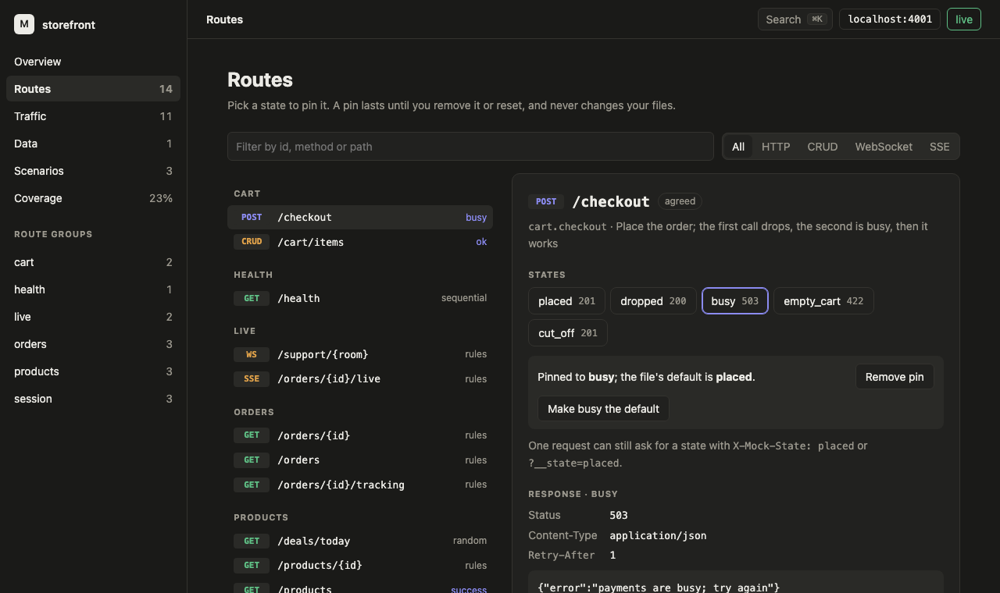
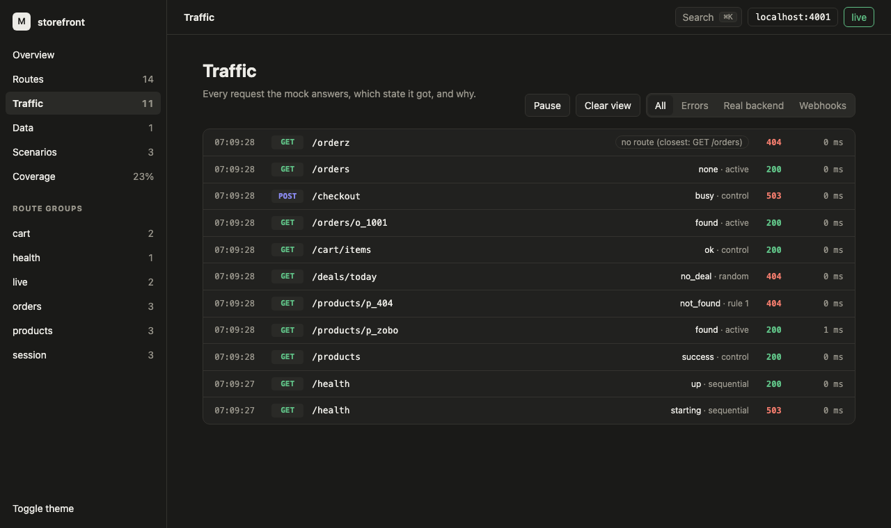

# Dashboard

A running mock serves a dashboard on its own port. Open the address `start` prints:

```text
dashboard on http://127.0.0.1:4001/__mockmachina/ui/
```

Opening the mock's own address, `http://127.0.0.1:4001/`, in a browser takes you there too. Only a browser opening the page is sent on: your app, curl and tests still get the mock's answer for `/`, and a route at `/` or a `--proxy` target always wins.

There's nothing to install and nothing to configure. The page is part of the `mockmachina` binary, works offline, and talks only to the mock that served it.



## What you can do

| View | What it shows | What you can change |
| --- | --- | --- |
| Overview | Routes and pins, requests and errors since start or reset, states served, the applied scenario, the newest requests | Nothing; each card links to its view |
| Routes | Every route by resource, with the state it's serving; one route's states, response, rules and a curl command | Pin a state, remove a pin, or make the pinned state the file's default |
| Traffic | Every request as it arrives: time, method, path, state, why that state, status and duration | Filter by errors, real backend or webhooks; pause; clear the view |
| Data | Each CRUD collection, its endpoints and seed file, and its items as a table | Delete an item; reset data and counters |
| Scenarios | Each scenario's routes and states, and which one is applied | Apply a scenario |
| Coverage | Which states each route has served, and the ones nobody has seen yet | Reset and start again |

Everything else stays in your files. The dashboard can't edit routes, states or bodies.

**Pins and the default.** Picking a state pins it: the route answers with that state until you remove the pin, reset, or stop the server. A pin never touches your files, so `git status` stays clean. "Make … the default" is the one action that writes a file: it changes the route's `active` line, as `mockmachina state set` does, and removes the pin.

**Reset** removes every pin and the applied scenario, and clears call counts, variables, CRUD collections, the request history and coverage. The page reloads with everything back to how the mock started.

**Hot reloads.** Save a routes or scenario file and the page updates by itself. Pins survive the reload.



## Keyboard

| Keys | What they do |
| --- | --- |
| <kbd>⌘K</kbd> or <kbd>Ctrl K</kbd> | Search routes and views; <kbd>↑</kbd> <kbd>↓</kbd> to move, <kbd>↵</kbd> to open |
| <kbd>/</kbd> | Filter routes on the Routes view, or search anywhere else |
| <kbd>g</kbd> then <kbd>o</kbd> <kbd>r</kbd> <kbd>t</kbd> <kbd>d</kbd> <kbd>s</kbd> <kbd>c</kbd> | Go to Overview, Routes, Traffic, Data, Scenarios or Coverage |
| <kbd>p</kbd> | Pause or resume Traffic |
| <kbd>?</kbd> | Show the shortcuts |
| <kbd>esc</kbd> | Close a dialog |

## Live updates

The page keeps one connection to the mock for live events. The pill in the top bar says `live` while it's connected. If you stop the mock it says `disconnected, retrying`, and it reconnects when the mock comes back.

Traffic adds each request at the top and keeps the newest 500. Pausing holds new rows back and counts them; resuming fills the list in from the mock's history, so nothing is missed. "Clear view" empties the list on screen only.

Counts in the sidebar and on the Overview cards refresh when you move between views or a file reloads, not on every request.

## From another machine

On your own machine the dashboard needs nothing. When `--host` makes the mock reachable from the network, other machines sign in once with the control token:

```text
control API on http://localhost:4001/__mockmachina/; other machines send "Authorization: Bearer 6QXK2G…"
dashboard on http://localhost:4001/__mockmachina/ui/; other machines sign in with the token
```

On the other device, open `http://<your computer's address>:4001/__mockmachina/ui/` and paste the token. The dashboard keeps it in a cookie that page scripts can't read, that only this mock's dashboard receives, and that's sent over HTTPS only when the mock serves HTTPS. Set `MOCKMACHINA_CONTROL_TOKEN` to choose the token yourself; see [who can use the control API](control-api.md#who-can-use-it).

## Safety

The dashboard follows the [control API](control-api.md)'s rules, and adds a few of its own:

- Requests from this machine must name it as `localhost`, `127.0.0.1` or `[::1]`. A website that points its own name at your machine needs the token like any other machine.
- A page from another site can't use the dashboard. Requests carrying another site's `Origin` are refused, and every change needs the `HX-Request` header that only the dashboard's own page sends.
- Every page sends a Content Security Policy that only allows the dashboard's own files. Route names, paths and bodies from your project are always shown as text, never run.
- The dashboard's scripts (htmx 2.0.7 and its server-sent events extension 2.2.3) ship inside the binary. Nothing loads from the internet.

## Browsers

The dashboard is checked in Chrome, Safari and Firefox, in light and dark themes and at phone width; see the [browser checklist](dashboard-checklist.md).
