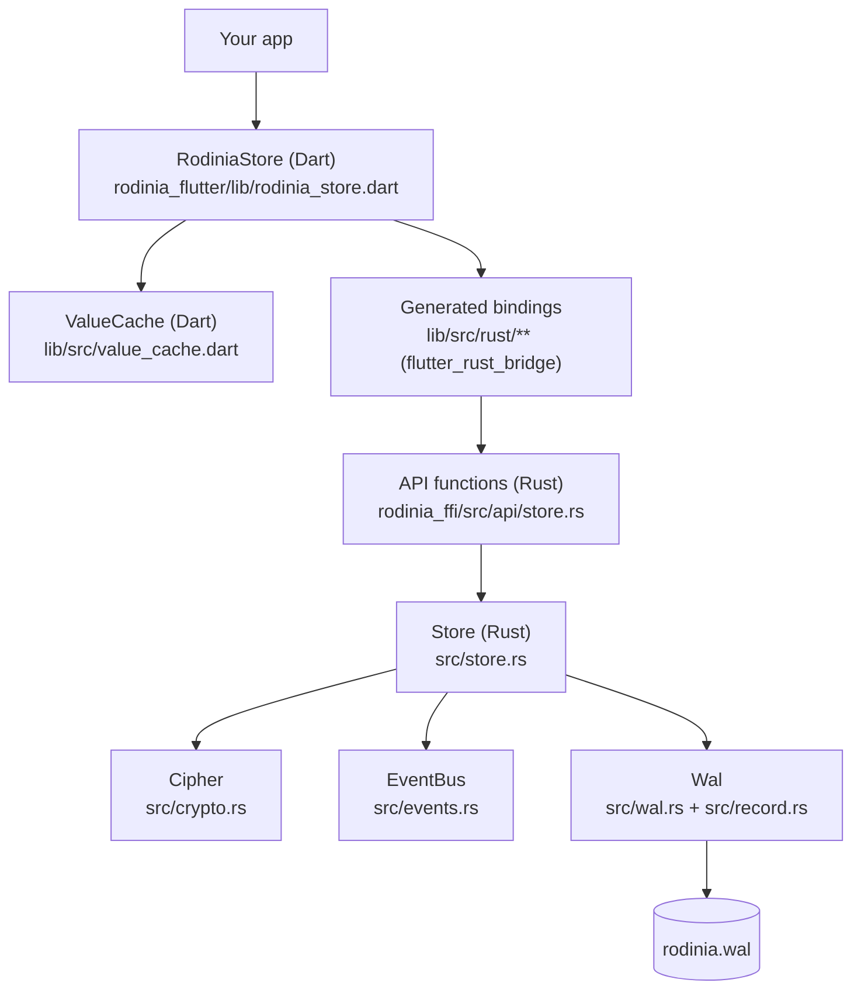
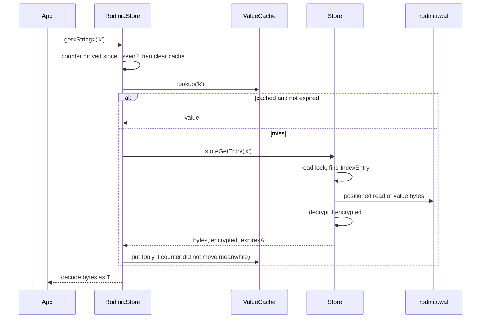

# Architecture

This page follows a call from Dart down to the file and back, and explains where
each piece of state lives and why it stays correct.

## The layers

| Layer | File | Owns |
|---|---|---|
| `RodiniaStore` | `rodinia_flutter/lib/rodinia_store.dart` | the public Dart API, turning Dart values into bytes and back, keeping its cache coherent |
| `ValueCache` | `rodinia_flutter/lib/src/value_cache.dart` | a least-recently-used map of recent values, capped in bytes |
| Bindings | `rodinia_flutter/lib/src/rust/**`, `rodinia_ffi/src/frb_generated.rs` | generated by flutter_rust_bridge; never edit by hand |
| API functions | `rodinia_ffi/src/api/store.rs` | the process-wide store singleton and one thin function per operation |
| `Store` | `rodinia_ffi/src/store.rs` | the index, locking, encryption, expiry, events, the change counter |
| `Wal` | `rodinia_ffi/src/wal.rs` | the log file: open, replay, append, read, compact |
| Records | `rodinia_ffi/src/record.rs` | the byte layout of one log record |
| `Cipher` | `rodinia_ffi/src/crypto.rs` | AES-256-GCM encryption of values |
| `EventBus` | `rodinia_ffi/src/events.rs` | fan-out of change events to `watch` streams |
| Legacy reader | `rodinia_ffi/src/legacy.rs` | reading the old (pre-0.2) log format once, to migrate it |

## One store per process

`rodinia_ffi/src/api/store.rs` holds the store in a `static STORE: OnceLock<Store>`.
The first `RodiniaStore.open(path)` in the process opens it; every later `open`
returns a new Dart handle to the **same** store and ignores its `path`
argument. Because Dart isolates in one app share the process, they also share
the store: a write from a background isolate is a write to the same index and
file the UI isolate reads.

Each Dart handle has its own `ValueCache`. Handles are cheap; the store is not
reopened.

## What lives in memory

**In Rust** (`State` in `store.rs`):

- `index: HashMap<String, IndexEntry>`: for every live key, where its value is
  in the file (`ValueLoc { offset, len }`), the size of its whole record, whether
  it is encrypted, and when it expires. The values themselves are **not** kept
  in Rust memory. That keeps Rust's memory proportional to the number of keys,
  not to the size of the data.
- `live_bytes`: the total size of the records the index points at. Compaction
  compares it with the file length to know how much of the file is dead.
- `wal`: the open file handles.

**In Dart** (per handle):

- `ValueCache`: recently read or written values, as the stored bytes plus,
  once known, the decoded `String` or scalar, so a repeated `get` does no
  decoding.
- `_seen`: the last value of the change counter this handle has accounted for.

## A read

The positioned read (`pread` on Unix, `seek_read` on Windows) needs no shared
file cursor, so many readers can read at once under the read lock.

## A write

`set` in Dart:

1. Encodes the value to bytes (a `String` as UTF-8, bytes as-is, anything else
   as JSON). A `Uint8List` you pass is copied first, so changing it afterwards
   cannot change what is cached.
2. Calls `storeSet` synchronously. Rust encrypts the value if asked (before taking
   the store lock), then takes the write lock, appends one record to the file,
   updates the index, and maybe compacts (see
   [Storage format](storage-format.md#compaction)).
3. Rust releases the lock, increments the change counter, and publishes a
   `KeyCreated` or `KeyUpdated` event.
4. Back in Dart, `_mutate` checks the counter (next section) and, if this was the
   only change, puts the value in the cache together with the original `String`
   or scalar, so the next `get` returns exactly the object you wrote.

## Keeping every cache correct: the change counter

Several things can change the store behind a Dart handle's back: another handle,
another isolate, or a direct call to the raw generated API. Rodinia handles all
of them with one number.

- `Store.generation` is an `AtomicU64`, boxed so its address never moves.
- Rust increments it once for every change: each set, delete, clear, counter
  update, list change, expiry of a key, key change (`setEncryptionKey`, `lock`)
  and import. It does **not** move for calls that change nothing (deleting a
  missing key, a `setIfAbsent` that finds the key) or for compaction, which
  moves bytes without changing any value.
- `storeGenerationAddress()` hands Dart the counter's address once; Dart reads it
  through a `Pointer<Uint64>` with no call into Rust.

Each handle remembers the counter value it last accounted for, `_seen`:

- **Before a read** (`_syncCache`): if the counter differs from `_seen`,
  someone else changed the store, so the whole cache is dropped.
- **Around its own write** (`_mutate`): it reads the counter before and after
  the call. The cache is patched only if the counter was still at `_seen`
  beforehand and moved by exactly the number of changes this call makes (one for
  a set, zero or one for a delete, the purged count for `purgeExpired`).
  Anything else means another writer slipped in, and the cache is dropped
  instead. If the call throws, the cache is dropped too.
- **When filling from a read** (`_load`, `getAll`, the preload): the value goes
  into the cache only if the counter did not move while it was being fetched.

Why this is safe: Rust increments the counter *after* the data has changed. So
a handle that sees the counter unchanged knows no change has happened that it
has not accounted for, or that it is about to see the counter move and drop
the cache.

Dropping the whole cache is coarse but cheap, and it is rare: only writes from
somewhere else cause it.

## The read cache

`ValueCache` is a `LinkedHashMap` used as a least-recently-used list: a hit is
removed and re-inserted at the end, so the first entry is always the oldest and
is evicted first. Every operation is O(1).

- **Size cap**: each entry costs `bytes + 2 × key length + 64`, an estimate
  of its real memory. When the total passes `cacheBytes` (default 8 MiB),
  the oldest entries are evicted. A single value bigger than the cap is
  simply not cached.
- **Expiry**: an entry remembers its expiry time; a lookup that finds it
  expired removes it and reports a miss.
- **Encrypted values** are cached decrypted. `setEncryptionKey` and `lock`
  drop every encrypted entry from the cache, so a wrong or missing key can never
  be bypassed by a cached plaintext.
- **"Complete"**: the cache knows when it holds every live key (after a
  `getAll`, a `clear`, or a complete preload). Then `getAll` is answered from
  the cache without calling Rust. Any eviction or skipped value clears the flag.
- **Copies**: `get<Uint8List>` returns a copy, and JSON maps and lists are
  decoded fresh on every read, so mutating a returned object never changes
  the cache. Strings, numbers and booleans are immutable and are shared.

## Preload

By default `RodiniaStore.open` starts a background fill of the new handle's cache
(`preload: true`). `storePreload` runs on a flutter_rust_bridge worker thread,
not on the calling isolate:

1. Under the read lock, it reads the change counter, collects the live,
   unencrypted index entries, sorts them by file offset, and reads their values in
   that order until the byte limit (`cacheBytes`) would be passed. Reading in
   file order makes it one forward pass over the file.
2. It returns the values, whether they were *all* the live keys (`complete`),
   and the counter value read under the lock.
3. Dart applies them only if the counter still equals that value; any write in
   between makes it discard the whole batch.

Encrypted values are never preloaded (the key is usually set after `open`); they
enter the cache as they are read. `preloaded` is a future that completes when
the fill is done; it is held in a static `Expando`, not on the handle, so a
handle can still be sent to another isolate.

## Threads and locks

- Almost every API function is marked `#[frb(sync)]`: it runs on the calling
  Dart isolate's thread and returns a value directly, not a `Future`. That is
  what makes `get` and `set` synchronous. The cost: a slow call (a `durable`
  write, a compaction) blocks that isolate for its duration.
- `storePreload` is the exception: it is async and runs on the bridge's worker
  pool.
- `Store.state` is a `parking_lot::RwLock`: reads (`get`, `contains`, `keys`,
  `getAll`, `preload`) share it; writes take it exclusively. A read that finds an
  expired key releases the read lock and takes the write lock to delete it.
- `Store.keyring` is a separate `RwLock` holding the encryption key and its
  prepared cipher, so encrypting and decrypting never wait on the state lock.
- `EventBus` keeps subscribers behind a `Mutex`; publishing happens after the
  state lock is released.

## Events

`watch(pattern)` returns a stream fed by `EventBus`.

| Event | Published by |
|---|---|
| `KeyCreated` | `set` of a new key, `setIfAbsent` that wrote, `increment`/`listPush` of a new key |
| `KeyUpdated` | `set`/`increment`/`listPush` of an existing key, `deleteFromList` that left items |
| `KeyDeleted` | `delete` of an existing key, `deleteFromList` that emptied the list |
| `KeyExpired` | a read, `contains`, `purgeExpired` or a list operation finding an expired key |
| `StorageCleared` | `clear`; sent to every subscriber regardless of pattern |
| `CacheInvalidated` | defined but never published |

Patterns: `*` matches every key; `auth.*` matches `auth` and any key starting
with `auth.`; `user*` matches keys starting with `user`; anything else must
match the key exactly. Subscribers whose stream has been closed are dropped the
next time an event is published. Key changes (`setEncryptionKey`, `lock`)
and `import` publish no events.

## Errors

Rust returns `StoreError` (`src/error.rs`); the bindings turn it into a Dart
exception of type `StoreError` with one subclass per variant, such as
`StoreError_EncryptionKeyNotSet`.

| Variant | Meaning |
|---|---|
| `NotInitialized` | a call before `open` |
| `AlreadyInitialized` | `storeOpen` called twice (the Dart `open` avoids this) |
| `Io` | the file could not be read or written |
| `Serialization` | a list value could not be decoded, or the key holds a non-list |
| `EncryptionKeyNotSet` | an encrypted value was written or read with no key set |
| `InvalidKeyLength` | `setEncryptionKey` got something other than 32 bytes |
| `Encryption`, `InvalidCiphertext`, `AuthenticationFailed`, `UnsupportedEncryptionVersion` | the value could not be encrypted, is malformed, was encrypted with another key or for another key name, or uses an unknown format |
| `InvalidCounterValue` | `increment` on a key whose value is not an integer |
